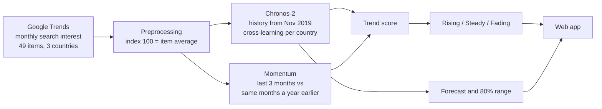

# Fashion Trend Forecast

**Search-interest forecasts for outfit items in England, France and Denmark, 3 and 6 months ahead, validated on a
held-out year.**

[](https://gauravmittal06.github.io/fashion_predictor/)


[](https://gauravmittal06.github.io/fashion_predictor/)

## Overview

The app forecasts monthly Google search interest for 41 outfit items, such as leather jackets, trench coats, satin
dresses, blazers and burgundy. Select a country, the items and a 3- or 6-month horizon to see:

- **Forecast:** observed search interest, the forecast and its 80% range.
- **Outlook:** each item labelled Rising, Steady or Fading against the same months of the previous year.
- **Validation:** test-year accuracy, a backtest of past forecasts against actual values, a log of every
  Rising/Fading call and a benchmark against WGSN.

The app runs entirely in the browser (Streamlit via [stlite](https://github.com/whitphx/stlite)). No server or
installation is required.

## Key results

Held-out test year **Nov 2025 – Oct 2026**. The model and labelling rule were selected on earlier data only, and each
forecast used only the data available at its forecast date.

| Metric | 3 months | 6 months |
|---|---|---|
| Labels correct (Rising / Steady / Fading) | **66%** | **64%** |
| Items labelled correctly on most forecast dates | **34 / 41** | **26 / 41** |
| Forecast error vs same-months-last-year baseline | **−33%** | **−24%** |
| Actual values within the 80% forecast range | **79%** | **77%** |
| Baseline: recent-trend rule, labels correct | 64% | 61% |
| Baseline: always "Steady", labels correct | 31% | 31% |

**Benchmark:** two WGSN trend calls (burgundy, Feb 2025; boho, Jun 2025) were compared with the model's forecast made
on the same date. The model was correct in 4 of 4 country cases and WGSN in 2 of 4.

## Methodology



1. **Data.** Monthly Google Trends search interest, Nov 2019 – Oct 2026, queried in each country's language (for
   example *veste en cuir* in France, *læderjakke* in Denmark). 49 items were collected; 8 with very low search volume
   were excluded, leaving 41.
2. **Forecasting.** [Chronos-2](https://huggingface.co/amazon/chronos-2), a pretrained time-series transformer, is
   used without training on these series. Each item's history from Nov 2019 is read, and the items of a country are
   forecast jointly (cross-learning). It was selected over Holt-Winters, a trend-plus-season model, a quantile LSTM and
   standard Chronos-2 because it had the lowest error in the selection period.
3. **Labelling.** Trend score = *w* × forecast change + (1 − *w*) × recent momentum, with *w* = 0.25 for 3 months and
   0.5 for 6 months, both selected on pre-test data. The label is **Rising** at +10% or more against the same months of
   the previous year, **Fading** at −10% or less, and **Steady** otherwise.
4. **Evaluation.** The final 12 months were held out until every modelling choice was fixed. They were then forecast
   from each successive forecast date using only earlier data.

## Getting started

The [live app](https://gauravmittal06.github.io/fashion_predictor/) needs no setup. To run it locally:

```bash
pip install -r requirements.txt
```

```bash
streamlit run app.py
```

## Reproducing the results

Rebuilding the forecasts runs Chronos-2; a GPU is recommended.

| Step | Command | Output |
|---|---|---|
| Forecasts and validation | `python scripts/build_forecasts.py` | `outputs/forecast/` |
| WGSN benchmark | `python scripts/check_wgsn.py` | `outputs/forecast/wgsn_check.csv` |
| Model-selection experiment | `python scripts/improve_forecasts.py` | `outputs/forecast/improve_results.csv` |
| Preview image and web page | `python scripts/make_preview.py`, then `python scripts/build_site.py` | `assets/preview.png`, `index.html` |

To extend the data, export each item group from [Google Trends](https://trends.google.com/) (country,
Nov 2019 – present, monthly) in the same format into `data/google_trends/`, then rerun the steps above.

## Repository structure

```
app.py                  Streamlit application
index.html              web page that runs app.py in the browser (stlite)
fpt/                    forecasting code and settings
scripts/                build, evaluation and publishing scripts
data/google_trends/     monthly search interest; terms.csv lists all items
outputs/forecast/       forecasts, validation results and backtest forecasts
outputs/models/         weights of the comparison LSTM
assets/                 preview image
```

## Limitations

- **Search interest is not sales.** It measures interest, which usually but not always leads to purchases.
- **Emerging trends.** Trends with no search activity yet, such as early runway signals, can't be detected from search
  data. Expert forecasts and this model complement each other.
- **Item-level accuracy.** Per-item test results come from 7–10 overlapping forecast windows and are indicative only.
- **Search terms.** The Danish term "leopard" includes searches unrelated to clothing.

## Acknowledgements

- [Chronos-2](https://github.com/amazon-science/chronos-forecasting), Amazon Science.
- [stlite](https://github.com/whitphx/stlite) for running Streamlit in the browser.
- Search data: [Google Trends](https://trends.google.com/).
- The comparison LSTM was trained on [GeoStyle](https://github.com/kavitabala/geostyle) (Mall et al., ICCV 2019).
