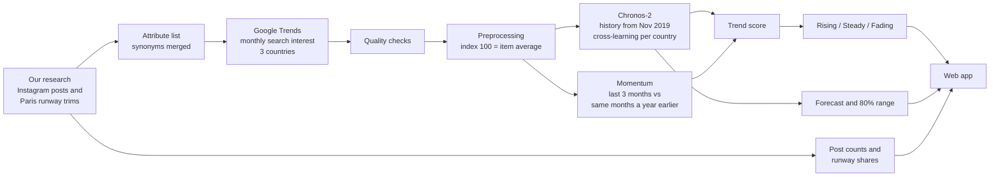

# Fashion Trend Forecast

**Search-interest forecasts for garments, fabrics, colours, styles and runway details in England, France and Denmark,
3 and 6 months ahead, validated on a held-out year and linked to our Instagram and Paris Fashion Week research.**

[](https://gauravmittal06.github.io/fashion_predictor/)


[](https://gauravmittal06.github.io/fashion_predictor/)

## Overview

The attributes come from our research: 202 Instagram posts from England, France and Denmark (2024–2025) and the trims
of 118 Chanel and Dior looks at Paris Fashion Week (2016–2025). Every garment, fabric, colour, style and runway detail
recorded often enough is tracked in monthly Google search data and forecast. Select a country, an attribute type, the
items and a 3- or 6-month horizon to see:

- **Forecast:** observed search interest, the forecast and its 80% range.
- **Outlook:** each item labelled Rising, Steady or Fading against the same months of the previous year, with how
  often it appears in our Instagram posts and how its share of runway looks has changed.
- **Research:** the most frequent attributes in our Instagram posts per country (and Autumn/Winter vs Spring/Summer),
  and the share of runway looks showing each detail per year, for Chanel and Dior.
- **Validation:** test-year accuracy, a backtest of past forecasts against actual values, a log of every
  Rising/Fading call and a benchmark against WGSN.

The app runs entirely in the browser (Streamlit via [stlite](https://github.com/whitphx/stlite)). No server or
installation is required.

### Coverage

<!-- coverage:start -->
| Type | England | France | Denmark | Examples |
|---|---|---|---|---|
| Garments | 20 | 20 | 16 | dress, trench coat, blazer, coat, shirt, sweater |
| Fabrics | 21 | 16 | 10 | cotton, wool, satin, knit, denim, tweed |
| Colours | 16 | 15 | 11 | white, black, beige, brown, blue, burgundy |
| Styles | 5 | 3 | 2 | casual, evening wear, formal / office, loungewear, boho |
| Runway details | 8 | 3 | 2 | floral details, embroidery, sequins & beads, pearls & crystals, gold hardware, studs & rivets |
| **Total** | **70** | **57** | **41** | |

168 forecast series in all. 51 attribute–country pairs are shown from the research data only, because Google has too few searches for them or they are not searched (listed in the app and in `data/google_trends/not_forecast.csv`).
<!-- coverage:end -->

## Key results

Held-out test year **Nov 2025 – Oct 2026**, all items in all three countries. The model and labelling rule were
selected on earlier data only, and each forecast used only the data available at its forecast date.

<!-- results:start -->
| Metric | 3 months | 6 months |
|---|---|---|
| Labels correct (Rising / Steady / Fading) | **68%** | **65%** |
| Rising / Fading calls correct | **572 / 765** (75%) | **357 / 507** (70%) |
| Items labelled correctly on most forecast dates | **137 / 168** | **113 / 168** |
| Forecast error vs same-months-last-year baseline | **−31%** | **−22%** |
| Actual values within the 80% forecast range | **78%** | **76%** |
| Baseline: recent-trend rule, labels correct | 65% | 62% |
| Baseline: always "Steady", labels correct | 44% | 46% |

**Benchmark:** two WGSN trend calls (burgundy, Feb 2025; boho, Jun 2025) were compared with the model's forecast made on the same date. The model was correct in 4 of 4 country cases and WGSN in 2 of 4.
<!-- results:end -->

## Methodology



1. **Attributes.** Every garment, fabric, colour, style and runway detail recorded at least twice in the Instagram
   posts or five times in the runway notes. Spelling variants are merged by one table (`fpt/attributes.py`), for
   example *creme* and *off white* → cream, *jumper* → sweater. Generic words (polyester, "mixed") are left out.
2. **Search terms.** Garments are searched as the plain word inside Google's Apparel category; fabrics, colours,
   styles and runway details as the word with a typical garment (*satin dress*, *robe en coton*, *sort kjole*), in
   each country's language.
3. **Data.** Monthly Google Trends search interest, Nov 2019 – Oct 2026. Each series must have all 84 months, at most
   10% empty months and an average of at least 3 on Google's 0–100 scale before the test year.
4. **Forecasting.** [Chronos-2](https://huggingface.co/amazon/chronos-2), a pretrained time-series transformer, is
   used without training on these series. Each item's history from Nov 2019 is read, and the items of a country are
   forecast jointly (cross-learning). It was selected over Holt-Winters, a trend-plus-season model, a quantile LSTM and
   standard Chronos-2 because it had the lowest error in the selection period.
5. **Labelling.** Trend score = *w* × forecast change + (1 − *w*) × recent momentum, with *w* selected on pre-test
   data for each horizon. The label is **Rising** at +10% or more against the same months of the previous year,
   **Fading** at −10% or less, and **Steady** otherwise.
6. **Evaluation.** The final 12 months were held out until every modelling choice was fixed. They were then forecast
   from each successive forecast date using only earlier data.
7. **Research data.** Only totals are published: for each attribute, the number of posts per country, season and
   year, and the share of runway looks per brand and year (`data/insights/`). No caption, link or account name is
   included.

## Getting started

The [live app](https://gauravmittal06.github.io/fashion_predictor/) needs no setup. To run it locally:

```bash
pip install -r requirements.txt
```

```bash
streamlit run app.py
```

## Reproducing the results

Rebuilding the forecasts runs Chronos-2; a GPU is recommended.

| Step | Command | Output |
|---|---|---|
| Choose the series | `python scripts/check_quality.py`, then `python scripts/select_series.py` | `data/google_trends/selected_*.csv`, `not_forecast.csv` |
| Forecasts and validation | `python scripts/build_forecasts.py` | `outputs/forecast/` |
| WGSN benchmark | `python scripts/check_wgsn.py` | `outputs/forecast/wgsn_check.csv` |
| Model-selection experiment (first 41 items) | `python scripts/improve_forecasts.py` | `outputs/forecast/improve_results.csv` |
| README tables, preview image, web page | `python scripts/make_readme.py`, `python scripts/make_preview.py`, `python scripts/build_site.py` | `README.md`, `assets/preview.png`, `index.html` |
| Tests | `python -m pytest` | |

New search terms are downloaded with `scripts/make_fetch_plan.py` (the list of requests), the Google Trends page and
`scripts/save_trends.py` (which checks and saves each download and logs it). The post and runway totals in
`data/insights/` are made from the team's private workbook; the tests that need it are skipped without it.

## Repository structure

```
app.py                  Streamlit application
index.html              web page that runs app.py in the browser (stlite)
fpt/                    forecasting code, attribute table, quality checks, settings
scripts/                download, build, evaluation and publishing scripts
tests/                  data, matching, output, privacy and app tests (pytest)
data/google_trends/     monthly search interest, downloads, request log and the selected series
data/insights/          Instagram post counts and runway shares (totals only)
outputs/forecast/       forecasts, validation results and backtest forecasts
outputs/models/         weights of the comparison LSTM
assets/                 preview image
```

## Limitations

- **Search interest is not sales.** It measures interest, which usually but not always leads to purchases.
- **Emerging trends.** Trends with no search activity yet, such as early runway signals, can't be detected from search
  data. Expert forecasts and this model complement each other.
- **Item-level accuracy.** Per-item test results come from 7–10 overlapping forecast windows and are indicative only.

## Acknowledgements

- [Chronos-2](https://github.com/amazon-science/chronos-forecasting), Amazon Science.
- [stlite](https://github.com/whitphx/stlite) for running Streamlit in the browser.
- Search data: [Google Trends](https://trends.google.com/).
- The comparison LSTM was trained on [GeoStyle](https://github.com/kavitabala/geostyle) (Mall et al., ICCV 2019).
