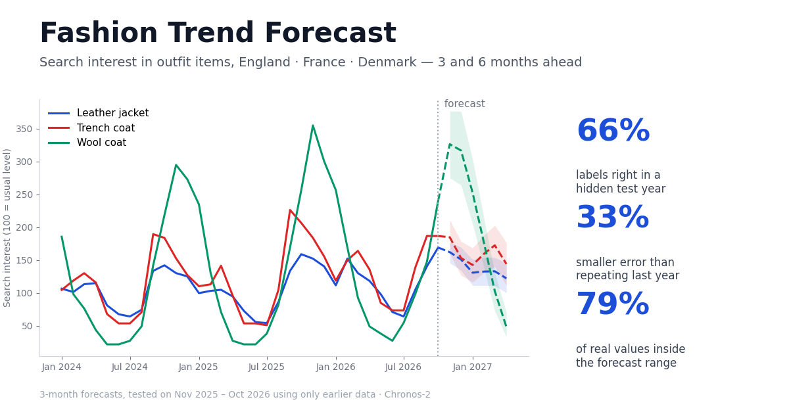
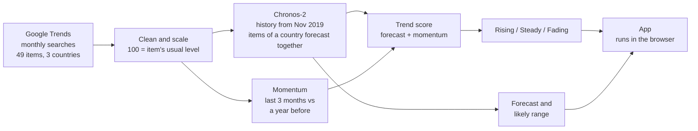

# Fashion Trend Forecast

**Where interest in outfit items is heading over the next 3 and 6 months, in England, France and Denmark.**

[](https://gauravmittal06.github.io/fashion_predictor/)


[](https://gauravmittal06.github.io/fashion_predictor/)

Choose a country, the outfit items you care about (leather jacket, trench coat, satin dress, blazer, burgundy and so on)
and a 3- or 6-month horizon. The app shows:
- **Forecast:** monthly search interest with the forecast and its likely range.
- **Label:** Rising, Steady or Fading, compared with the same months last year.
- **Track record:** how often the forecast was right for that item in a hidden test year.

The app runs entirely in your browser. There is no server and nothing to install.

---

## Results

Tested on a **hidden year (Nov 2025 – Oct 2026)**. Every choice of method was made on earlier months only. Each test
forecast used only the data available at the time.

| Hidden test year | 3 months ahead | 6 months ahead |
|---|---|---|
| Rising / Steady / Fading labels right | **66%** | **64%** |
| Items labelled right most of the time | **34 of 41** | **26 of 41** |
| Error compared with repeating last year | **33% smaller** | **24% smaller** |
| Real values inside the forecast range (aim 80%) | **79%** | **77%** |
| *Always saying "Steady"* | *31%* | *31%* |
| *"The recent trend continues" rule* | *64%* | *61%* |

## Proof built into the app

| | |
|---|---|
| 🕰️ **Time machine** | Go back to any month since Dec 2023. See the forecast the model made with only the data up to then, next to what really happened. |
| 📋 **Track record** | Every Rising / Fading call in the hidden year, each marked right or wrong. |
| 🥊 **Against the professionals** | Two trend calls by WGSN, a leading paid trend-forecasting service, checked against what searches did next. Our model got 4 of 4; WGSN got 2 of 4. |
| 🔒 **Sealed forecast** | Today's forecast is saved with a SHA-256 fingerprint, so it cannot be changed unnoticed. The app scores it automatically as new months arrive. |

## How it works



1. **Data:** monthly Google search interest for 49 outfit items, Nov 2019 – Oct 2026. Each item is searched in its
   country's language, for example *veste en cuir* in France and *læderjakke* in Denmark. Eight items too rarely
   searched to forecast were left out, leaving 41.
2. **Forecaster:** [Chronos-2](https://huggingface.co/amazon/chronos-2), a pretrained time-series model, used
   without training on this data. It reads each item's history from Nov 2019 and forecasts all items of a country
   together (cross-learning), so it can tell when interest in everything is moving. It was chosen over
   Holt-Winters, a seasonal baseline, a quantile LSTM and the plain Chronos-2, because it had the lowest error on the
   development months.
3. **Label:** trend score = forecast change mixed with recent momentum: 25 / 75 at 3 months, 50 / 50 at 6 months,
   both chosen on development months. **Rising** at +10% or more against the same months last year, **Fading** at
   −10% or less, otherwise **Steady**.
4. **Testing:** the last 12 months were locked away until every choice was made, then forecast once from every
   start month, using only earlier data each time.

## Run it yourself

The live site needs nothing. To run it locally:

```bash
pip install -r requirements.txt
```

```bash
streamlit run app.py
```

To rebuild everything from the data (Chronos-2 runs best on a GPU):

| Step | Command | Output |
|---|---|---|
| Forecasts, tests and sealed forecast | `python scripts/build_forecasts.py` | `outputs/forecast/`, `sealed/` |
| Comparison with WGSN | `python scripts/check_wgsn.py` | `outputs/forecast/wgsn_check.csv` |
| The improvement experiment (20 options) | `python scripts/improve_forecasts.py` | `outputs/forecast/improve_results.csv` |
| Check the sealed forecast is untouched | `python scripts/verify_seal.py` | |
| Preview picture and the web page | `python scripts/make_preview.py`, then `python scripts/build_site.py` | `assets/preview.png`, `index.html` |

To add new months, open each group of items in [Google Trends](https://trends.google.com/) (country,
Nov 2019 – today, monthly) and save it in the same format in `data/google_trends/`. Then run the steps above.

## Project structure

```
app.py                  the app (Streamlit)
index.html              the website: runs app.py in the browser with stlite
fpt/                    forecasting code and settings
scripts/                build, test, check and publish scripts
data/google_trends/     monthly search interest; terms.csv lists every item
outputs/forecast/       forecasts, test results and every past forecast
outputs/models/         the comparison LSTM's weights
sealed/                 sealed forecasts with their fingerprints
assets/                 preview picture
```

## Limits

- **Searches, not sales.** Search interest is a signal of interest, not of what is bought.
- **New trends.** A trend that hasn't started yet, such as one only seen on the catwalk, can't be seen in search data.
  Expert forecasts and this model work best together.
- **Overlapping checks.** The test year gives 7 to 10 checks per item, and they overlap. So one item's own record is
  only a rough guide.
- **"Leopard" in Denmark.** It counts every search for the word, not only clothes.

## Acknowledgements

- [Chronos-2](https://github.com/amazon-science/chronos-forecasting) by Amazon Science.
- [stlite](https://github.com/whitphx/stlite) runs Streamlit in the browser.
- Search data: [Google Trends](https://trends.google.com/).
- The comparison LSTM was trained on [GeoStyle](https://github.com/kavitabala/geostyle) street-style trends (Mall et al., ICCV 2019).
